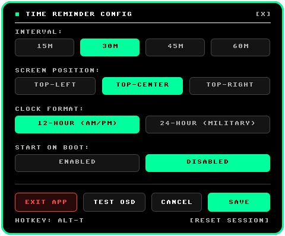

# Time Reminder


**Native Windows HUD timer and session tracker for PC gamers.**
Built in pure Rust. Zero hooks, zero DLL injection, 367 KB standalone binary.

[Overview](#overview) &bull; [Features](#features) &bull; [Quick Start](#quick-start) &bull; [Controls](#controls) &bull; [CLI Options](#cli-options) &bull; [Configuration](#configuration) &bull; [How It Works](#how-it-works) &bull; [Building from Source](#building-from-source)

---

## Overview

Time Reminder is a background Windows application that briefly flashes a retro 8-bit Split Pod Card over your screen at set intervals. It displays the current digital clock alongside your active gaming session time, helping you keep track of time during immersive full-screen gaming sessions without breaking focus.


## Features

- **Safe for Anti-Cheat**: Zero process memory modification, zero DirectX/Vulkan/OpenGL hooking, and no DLL injection. Time Reminder renders through the standard Windows desktop window manager as a click-through layered window.
- **Minimal Resource Footprint**:
  - Binary size: **367 KB** standalone executable (no external runtimes, no extra DLLs).
  - Memory: **< 3 MB RAM** working set.
  - CPU: **0.0%** at idle.
- **Smart Game Detection**: Uses Win32 user notification state (`SHQueryUserNotificationState`) and foreground window bounds to detect full-screen games. Session playtime pauses automatically when you Alt-Tab or close the game.
- **Click-Through HUD**: Rendered with `WS_EX_TRANSPARENT | WS_EX_NOACTIVATE | WS_EX_TOPMOST`. Mouse clicks pass through directly to your game without interrupting input or stealing focus.
- **Custom 8-Bit Software Renderer**: Handcrafted arcade bitmap font rendered into a 32bpp BGRA buffer with antialiased rounded pill corners and slide-in animations.
- **Interactive Retro Settings GUI**: Toggle reminder intervals (15m, 30m, 45m, 60m), clock format (12h/24h), screen position, and startup boot behavior from the tray menu or the retro settings window.



## Quick Start

### Download and Run

1. Grab the latest release archive (`time-reminder-v0.1.0-windows-x64.zip`) from the Releases page or [`dist/`](dist/).
2. Extract the folder anywhere on your computer.
3. Double-click `TimeReminder.bat` or run `time-reminder.exe`.

When launched, the reminder card flashes once in the top-right corner to confirm it is active, then sits quietly in your system tray.

### Controls

| Action | How to Trigger |
|---|---|
| **Manual Flash** | Press `Alt + T` anytime (including during full-screen games) |
| **System Tray Menu** | Right-click the hourglass icon in the Windows taskbar tray |
| **Open Settings GUI** | Click **Settings...** in the tray menu, or run `time-reminder.exe --settings` |
| **Reset Session** | Click **Reset Session Time** in the tray menu |
| **Test Notification** | Click **Test Notification** in the tray menu, or run `time-reminder.exe --test-overlay` |
| **Quit** | Click **Exit** in the tray menu |

## CLI Options

```cmd
# Run daemon normally
time-reminder.exe

# Flash test overlay for 4 seconds and exit
time-reminder.exe --test-overlay

# Open retro settings dialog directly
time-reminder.exe --settings
```

## Configuration

Settings are saved in `config.json` next to `time-reminder.exe`. You can edit this file directly or use the Settings GUI:

```json
{
  "interval_minutes": 30,
  "display_duration_secs": 4,
  "position": "top-right",
  "time_format": "12h",
  "theme": "monochrome",
  "run_on_startup": false
}
```

| Field | Options | Default | Description |
|---|---|---|---|
| `interval_minutes` | `15`, `30`, `45`, `60` | `30` | Active gaming time between reminder alerts. |
| `display_duration_secs` | Integer (e.g. `4`) | `4` | How long the reminder card stays visible on screen. |
| `position` | `"top-right"`, `"top-center"`, `"top-left"` | `"top-right"` | Screen anchor location for the overlay. |
| `time_format` | `"12h"`, `"24h"` | `"12h"` | Clock display format (12-hour with AM/PM or 24-hour). |
| `theme` | `"monochrome"` | `"monochrome"` | Card aesthetic (pure high-contrast black and white). |
| `run_on_startup` | `true`, `false` | `false` | Automatically launch Time Reminder when Windows boots. |

## How It Works

1. **Detection Loop**: Every second, the tracker inspects the system display state via `SHQueryUserNotificationState`. If a full-screen Direct3D or desktop application is in focus, the session timer ticks forward. If the system is idle or you Alt-Tab to a desktop browser, the timer pauses.
2. **Overlay Presentation**: When the target interval elapses, Time Reminder calculates the bounding box on the target display monitor and positions a layered window (`WS_EX_LAYERED`). The window alpha transitions smoothly via cubic easing equations (`ease_out_cubic` on entry, `ease_in_cubic` on exit).
3. **Software Pixel Pipeline**: Software buffers are written directly into a pre-multiplied 32bpp DIB section (`PixelBuffer`), drawn via `UpdateLayeredWindow`, and handed off to Desktop Window Manager (DWM) for compositing.

## Building from Source

### Prerequisites

- [Rust toolchain](https://www.rust-lang.org/tools/install) (Rust 1.70+ or 2021 edition)
- Windows 10 or 11 (x86_64)

### Build Commands

```cmd
# Clone the repository
git clone https://github.com/<owner>/time-reminder.git
cd time-reminder

# Run the test suite (32 unit and integration tests)
cargo test

# Compile optimized release binary
cargo build --release
```

The compiled standalone executable is generated at:
```
target\release\time-reminder.exe
```

## License

This project is licensed under the [MIT License](LICENSE).
